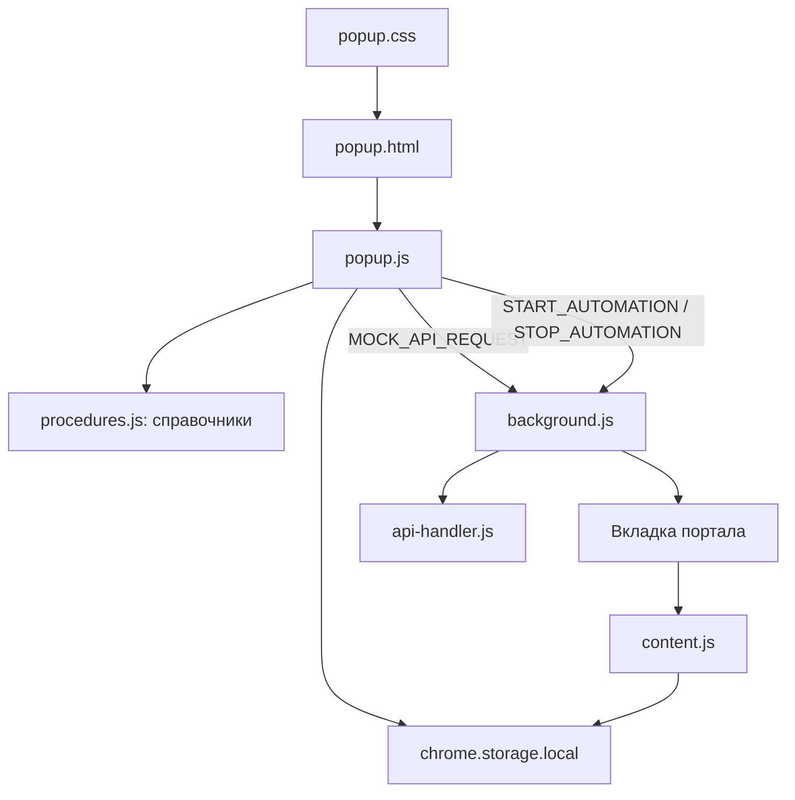

# Popup: назначение и устройство

## Роль в расширении

`popup.html`, `popup.css` и `popup.js` образуют окно расширения, открываемое через `action.default_popup` в `manifest.json`. Popup — панель управления, а не исполнитель автоматизации:

- показывает состояние подключения и локального режима;
- собирает и проверяет параметры поиска;
- сохраняет форму в `chrome.storage.local`;
- отправляет фоновой службе команды запуска и остановки;
- наполняет списки процедур и офисов данными из `procedures.js`.

После запуска popup не управляет страницей портала напрямую. Фоновая служба из `background.js` открывает вкладку, а `content.js`, подключенный через `content_scripts` в manifest, работает на странице портала.

## Связи файлов и компонентов

- `popup.html` задает разметку и идентификаторы элементов, к которым обращается JavaScript.
- `popup.css` оформляет эти элементы и их состояния.
- `popup.js` обрабатывает состояние интерфейса, пользовательский ввод, сохранение и команды расширения.
- `procedures.js` экспортирует `PROCEDURES`, `CITIES`, `DEFAULT_CITY_PROCEDURES`, `PROCEDURES_REQUIRE_DOC_TYPE`, `PROCEDURE_META` и `OFFICES`.
- `background.js` принимает `START_AUTOMATION` и `STOP_AUTOMATION`.
- `api-handler.js` отвечает на `MOCK_API_REQUEST` локальными ответами. Popup сам не обращается к внешнему API.
- `content.js` получает сохраненные `userData` и выполняет проход по страницам портала. В локальном режиме он останавливается до выбора времени, CAPTCHA/SMS и подтверждения.



## Последовательность запуска popup

1. Браузер открывает `popup.html`, подключает `popup.css`, затем загружает `popup.js` как ES-модуль.
2. В начале `popup.js` импортирует справочники из `procedures.js` и находит нужные DOM-элементы по `id`.
3. Обработчик `DOMContentLoaded` читает состояние из `chrome.storage.local`.
4. При `LOCAL_TEST_MODE === true` popup показывает панель `authorizedSection` с именем `Локальный тест`. Это локальное состояние интерфейса, не реальная учетная запись.
5. `showAuthorized()` запрашивает статус у mock через `requestMockApi("verify_access")`. Ответ отображается как «Локальная отладка».
6. `initForm()` создает список провинций из `Object.keys(CITIES)`, а `loadUserData()` восстанавливает сохраненные поля и выборы.
7. Popup подключает обработчики изменения провинции, процедуры, типа документа, офисов и кнопки запуска.

Старые панели Telegram-авторизации и связанные функции остаются в коде для совместимости, но в локальном режиме начальный экран авторизации пропускается.

## Последовательность работы формы

1. При выборе провинции обработчики `userCity` обновляют список процедур и офисов. Предыдущая процедура сбрасывается.
2. `renderProcedures(city)` берет идентификаторы из `CITIES[city]`; если записи нет, применяется `DEFAULT_CITY_PROCEDURES`. Названия берутся из `PROCEDURES`.
3. Если для сочетания процедуры и провинции в `PROCEDURE_META` указан `status: "entrar_onlyClave"`, соответствующая процедура отображается отключенной.
4. `renderOffices(city)` строит список офисов из `OFFICES[city]`. Пользователь может выбрать все офисы, отдельные офисы и режим `prefer` или `strict`.
5. Изменение процедуры вызывает `updateDocumentTypeByMeta()` и `updateDocumentInputsVisibility()`. Доступность NIE и паспорта зависит от `PROCEDURE_META`, а необходимость показывать переключатель типа документа — от `PROCEDURES_REQUIRE_DOC_TYPE`.
6. Обработчики ввода нормализуют значения: имя и документы переводятся в верхний регистр, телефон очищается от нецифровых символов, email переводится в нижний регистр.
7. Нажатие «Начать» вызывает `handleStart()`. Если процесс уже включен, обработчик выключает его и посылает `STOP_AUTOMATION`.
8. Для нового запуска выполняются проверка процедуры и `validateForm()`. При ошибке сообщение выводится в `formError`.
9. После успешной проверки формируется `payload`, сохраняется в `userData`, устанавливается `isEnabled: true`, поля блокируются, а кнопка меняется на «Стоп».
10. Popup отправляет `START_AUTOMATION` вместе с `payload`. Background открывает целевую вкладку и сохраняет ее `activeTabId`.

## Поля формы и проверка

| DOM id / параметр | Назначение | Проверка в popup |
| --- | --- | --- |
| `userCity` / `city` | Провинция портала | Обязательно; список из `CITIES` |
| `userProcedure` / `procedure` | Идентификатор процедуры | Обязательно; число из списка выбранной провинции |
| `office_cb` / `offices` | Выбранные офисы | Массив значений `OFFICES`; пустой массив означает любой офис |
| `officeMode` | Политика выбора офисов | `prefer` — предпочитать; `strict` — требовать выбранный офис |
| `userName` / `name` | ФИО | Обязательно; только латинские заглавные буквы и пробелы (`^[A-Z\\s]+$`) |
| `docNie` + `userNie` / `documentType`, `nie` | Тип документа и NIE | NIE: буква, цифры, завершающая буква (`^[A-Z][0-9]+[A-Z]$`) |
| `docPassport` + `userPassport` / `documentType`, `passport` | Тип документа и паспорт | Паспорт должен быть непустым; ввод ограничен девятью символами |
| `userTel` / `tel` | Испанский телефон | 9 цифр, первая цифра 6 или 7 (`^[67]\\d{8}$`) |
| `userEmail` / `email` | Контактный email | Формат `local@domain.tld` |

`documentType` в payload принимает `NIE` или `PASSPORT`. Для NIE поле `passport` записывается пустым; для паспорта в `nie` остается текущее значение формы, если оно не было очищено обработчиком выбора документа.

`offices` содержит строковые значения отмеченных `.office_cb`. Пустой массив при обработке на стороне `content.js` означает, что подходит любой доступный офис; это отличается от выбора конкретных офисов с режимом `strict`.

## Переменные и параметры popup

| Переменная | Где | Значение и назначение |
| --- | --- | --- |
| `LOCAL_TEST_MODE` | `popup.js` | Булев переключатель локального UI. `true` показывает локального пользователя и пропускает production-экран авторизации. Для полного локального прохода должен согласовываться с одноименным флагом в `content.js`. |
| `STATES` | `popup.js` | Имена состояний интерфейса: `NOT_AUTH`, `WAIT_TG`, `AUTHORIZED`. |
| `currentState` | `popup.js` | Текущее состояние панели; в локальном режиме при запуске popup устанавливается в `AUTHORIZED`. |
| `authCode` | `popup.js` | Временный код старого Telegram-сценария; в локальном режиме для запуска не требуется. |
| `accessState` | `popup.js` | Последний ответ `verify_access`, используемый для отображения статуса доступа. Mock возвращает `access: "test"`. |
| `accessFetchInProgress` | `popup.js` | Не допускает параллельную загрузку статуса доступа. |
| `isFormLocked` | `popup.js` | Запрещает изменение документа при активном поиске. |
| `citiesList` | `popup.js` | Названия провинций, вычисленные через `Object.keys(CITIES)`. |
| `payload` | `handleStart()` | Снимок введенной формы, сохраняемый как `userData` и передаваемый в `START_AUTOMATION`. |
| `mode` | `requestMockApi(mode, payload)` | Имя команды mock API; popup использует `verify_access` и `check_auth`. |
| `payload` | `requestMockApi(mode, payload = {})` | Дополнительные данные команды. Отправляются сообщением `MOCK_API_REQUEST`; по умолчанию пустой объект. |

Ключевые параметры валидации определены внутри `validateForm()`: латинское имя `/^[A-Z\\s]+$/`, NIE `/^[A-Z][0-9]+[A-Z]$/`, телефон `/^[67]\\d{8}$/`, email `/^[^\\s@]+@[^\\s@]+\\.[^\\s@]+$/`. Обработчики ввода ограничивают NIE и паспорт девятью символами, а телефон — девятью цифрами.

## Payload и хранилище

При запуске `handleStart()` передает объект следующей структуры:

```js
{
  name: string,
  nie: string,
  passport: string,
  documentType: "NIE" | "PASSPORT",
  tel: string,
  email: string,
  city: string,
  procedure: number,
  offices: string[],
  officeMode: "prefer" | "strict"
}
```

Основные ключи `chrome.storage.local`, используемые popup:

- `userData` — последний payload формы.
- `isEnabled` — состояние процесса; влияет на подпись кнопки и блокировку формы.
- `userProcedure` — отдельно сохраненное значение выбранной процедуры.
- `state`, `authCode`, `userId`, `hash`, `username`, `first_name` — ключи старого Telegram-сценария; часть из них в локальном режиме не нужна.

При запуске `popup.js` вызывает `loadUserData()`. При смене города удаляет отдельно сохраненный `userProcedure`; при выборе документа `persistDocumentType()` обновляет поле `documentType` в `userData`.

## Сообщения и локальный mock

`requestMockApi(mode, payload)` отправляет в background сообщение:

```js
{
  action: "MOCK_API_REQUEST",
  mode: string,
  payload: object
}
```

Сам popup использует режимы `verify_access` и `check_auth`. `api-handler.js` проверяет идентификатор отправителя и разрешенный список режимов, затем синхронно возвращает тестовый объект. Вызовов `fetch()` к `citaext.vercel.app` из рабочего пути popup нет.

`LOCAL_TEST_MODE` в `popup.js` управляет начальным локальным состоянием интерфейса. Аналогичный флаг в `content.js` управляет поведением тестового прохода страницы; это отдельная настройка, их значения должны оставаться согласованными. В popup также закомментирован production-gate, который раньше блокировал запуск без доступа или при исчерпанном demo-лимите.

## DOM-контракт popup

Переименование перечисленных `id` требует синхронного изменения `popup.js`:

- Состояния: `notAuthSection`, `waitTGSection`, `authorizedSection`.
- Авторизация и статус: `authStartBtn`, `authCheckBtn`, `authCodeText`, `authStatus`, `connectedUserName`, `logoutBtn`, `accessStatus`, `accessHint`.
- Копирование кода: `copyAuthCodeBtn`.
- Форма: `userCity`, `userProcedure`, `userName`, `userNie`, `userTel`, `userEmail`, `userPassport`, `docNie`, `docPassport`, `docTypeWrapper`, `nieWrapper`, `passportLabel`.
- Офисы: `officeWrapper`, `officeLabel`, `officeToggle`, `officeContent`, `officeList`, `office_any`, `selectedOfficeSummary`; динамические элементы используют класс `office_cb`.
- Управление запуском: `formError`, `startBtn`.

## Инструкция по проверке popup

1. На странице `chrome://extensions` перезагрузить расширение после изменения файлов.
2. Открыть popup: ожидаются имя «Локальный тест» и статус «Локальная отладка».
3. Выбрать провинцию и процедуру, заполнить тестовые значения в требуемом формате; проверить, что список офисов и поля документов меняются вместе с выбором.
4. Нажать «Начать»: popup должен заблокировать форму, сменить кнопку на «Стоп» и передать payload фоновому скрипту.
5. На вкладке портала проверяется проход до границы отладки. При достижении слота, CAPTCHA, SMS или подтверждения процесс останавливается; popup после повторного открытия восстановит сохраненные данные.
6. Нажать «Стоп» до границы, чтобы проверить команду остановки и разблокировку формы.

Popup проверяет только формат введенных значений и локальные данные. Он не подтверждает доступность реальной процедуры, не резервирует слот и не подтверждает запись.
